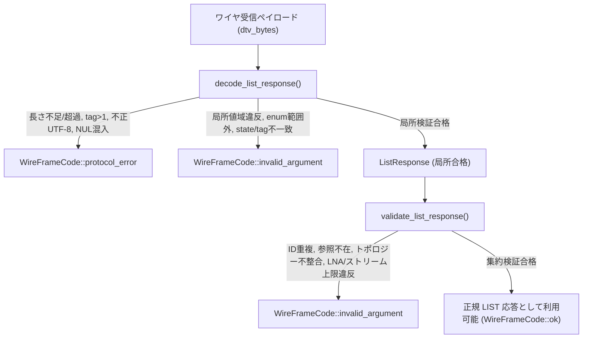

<!-- SPDX-License-Identifier: GPL-2.0-or-later -->
# UDTV 1.1 LIST 応答ペイロードコーデック仕様

本文書は、正本 L2 仕様（`spec/dtv11-l2-spec.md` §5、決定 63）が継承する凍結 wire-records（`ba835777`）仕様に基づく、UDTV 1.1 における LIST 応答（opcode `0x0010`、`flags = 1`）の typed payload 純コーデック（PR78）の実装利用境界、データ構造、および外部契約を記録したものである。

## 概要と位置づけ

- **積層関係:** 20 byte UDTV 1.1 外郭 envelope（`include/dtv/internal/wire-envelope.hpp`、`encode_frame`）の内側に積層される、typed payload の直列化・非直列化層である。20 byte 外郭ヘッダーはペイロードサイズ（`list_response_payload_size`）には含まない。
- **純粋な計算契約:**
  - I/O なし、時計読み取りなし、スレッド生成なし、外部大域状態アクセスなしの純関数として実装される。
  - 動的メモリ確保（ヒープアロケーション）を行わず、すべて固定上限の所有配列型（`WireText<N>`, `WireOptional<T>`, `WireArray<T, N>`）を用いる。
  - デコード結果（`ListResponse`）は入力バッファ（`dtv_bytes`）への借用ポインタを残さない完全所有値型である。
- **無変更失敗保証:**
  - デコード失敗時は出力先構造体（`ListResponse *value`）の内容を一切変更しない。
  - エンコード失敗（容量不足等）時は出力先バッファ（`dtv_buffer *output`）のメモリ内容および `output->size` を一切変更しない。
- **スコープ境界:**
  - 受信 epoch の照合、セッション世代照合、および不一致時のエラーフレーム（`NOT_FOUND` 等）生成は上位接続ゲート（host runtime / gate）の責務であり、本コーデック内では行わない。
  - L3 決定 66 に基づく USB シリアル観測値の取得、機種導出 SPI 呼び出し、および一意性（`uniqueness`）の判定はスナップショット mapper 側の責務であり、本コーデックは渡された値をそのまま直列化・非直列化する。
  - STATUS 要求/応答コーデック、常駐デーモン、クライアントライブラリ、および CLI への接続は本 PR の対象外である。

---

## 1. 実在 API と呼出順序（二段階検証プロトコル）

Core 内部ヘッダー `include/dtv/internal/wire-list-response.hpp` にて以下の 4 つの API が提供される。

```cpp
namespace dtv::internal {

WireFrameCode list_response_payload_size(const ListResponse &value, std::size_t *size);
WireFrameCode encode_list_response(const ListResponse &value, dtv_buffer *output);
WireFrameCode decode_list_response(dtv_bytes payload, ListResponse *value);
WireFrameCode validate_list_response(const ListResponse &value);

}
```

### API 契約

1. **`list_response_payload_size`:**
   - 入力 `value` に対して内部で集約検証 `validate_list_response(value)` を実行し、合格した場合のみ正確なペイロード長（バイト数）を `*size` に書き込む。
   - 検証に失敗した場合は該当するエラーコード（`WireFrameCode::invalid_argument`）を返却し、サイズ計算を行わない。
   - 計算されたペイロード長が制御フレーム上限 `kWireMaxControlPayload`（65,536 byte）を超える場合も `invalid_argument` を返却する。
2. **`encode_list_response`:**
   - 内部で `list_response_payload_size` を呼び出して集約検証と必要サイズを判定する。
   - `output->capacity` が必要サイズ未満の場合、`WireFrameCode::buffer_too_small` を返却し、バッファ内容および `output->size` を一切変更しない（無変更保証）。
   - 容量が十分な場合のみ、ペイロードを順次リトルエンディアンで書き込み、`output->size` に実サイズを設定して `WireFrameCode::ok` を返却する。
3. **`decode_list_response`:**
   - ペイロードサイズが最小長 44 byte 未満、または最大長 65,536 byte 超の場合、直ちに `WireFrameCode::protocol_error` を返却する。
   - 一時オブジェクト（ローカル変数）上にデコードを進め、末尾到達性、バイト長、UTF-8 妥当性、NUL 文字非含有、タグ値、および局所値域（`validate_local`）を検証する。
   - 途中でデータ不足や構文違反が検出された場合は `protocol_error` または `invalid_argument` を返却し、呼び出し元の `*value` は一切変更しない。
   - 局所検証まで合格した場合のみ、`*value` に内容をコピーして `WireFrameCode::ok` を返却する。
4. **`validate_list_response`:**
   - 局所値域検証（`validate_local`）に加え、配列間・要素間の相互参照、ID 一意性、およびトポロジーとの集合整合性を検証する（集約検証）。

### 呼出順序と検証必須契約

> [!IMPORTANT]
> **`decode_list_response` の成功だけで正規 LIST 成功とみなしてはならない。**
> `decode_list_response` はバイト列からの復元と局所構造の検証のみを行う。正規の LIST 応答として受領・処理するためには、受信側は必ずデコード直後に別個に `validate_list_response` を呼び出し、集合・参照整合性を確認しなければならない。

```cpp
// 受信側の正規呼出シーケンス例
dtv::internal::ListResponse response;
auto code = dtv::internal::decode_list_response(payload_bytes, &response);
if (code != dtv::internal::WireFrameCode::ok) {
    // ペイロード構文・局所値エラー処理（PROTOCOL_ERROR / INVALID_ARGUMENT）
    return code;
}

// 必須の集約検証（ID重複、参照実在、トポロジー整合性等の全域検証）
code = dtv::internal::validate_list_response(response);
if (code != dtv::internal::WireFrameCode::ok) {
    // 集合整合性エラー処理（INVALID_ARGUMENT）
    return code;
}
// 正規 LIST 応答として利用可能
```

---

## 2. ペイロード構造と全フィールド配置

LIST 応答ペイロードは、20 byte の UDTV 1.1 外郭ヘッダー直後を offset 0 とする。リトルエンディアン（LE）、パディングなしで隙間なく直列化される。

### トップレベル構造（8 フィールド）

| 順序 | フィールド名 | 内部型 | ワイヤ表現 / 長さ | 規則・境界 |
| :--- | :--- | :--- | :--- | :--- |
| 1 | `epoch` | `std::array<uint8_t, 16>` | `opaque[16]` (16 byte) | offset 0。全 0 もコーデックは受理。照合はゲートの責務 |
| 2 | `producer` | `ListProducer` | 可変長 (4〜166 byte) | offset 16。product → version → core_version |
| 3 | `snapshot` | `ListSnapshot` | 16 byte (u64 LE × 2) | sequence (8 byte) + observed_at_ns (8 byte)。0 も保持 |
| 4 | `topology` | `ListTopology` | 1〜3 byte | state (1 byte) + expected_function_count (opt<u16 LE>) |
| 5 | `enclosure` | `WireOptional<ListEnclosure>` | 1 byte (tag 0) または可変長 | tag 0/1。筐体記述子 |
| 6 | `functions` | `WireArray<ListUsbFunction, 8>` | 2 byte (count) + 各要素 | USB 機能配列。count 0..8 |
| 7 | `receivers` | `WireOptional<WireArray<ListReceiver, 32>>` | 1 byte (tag 0) または 3 byte + 各要素 | レシーバー配列。tag 0/1、count 0..32 |
| 8 | `readers` | `WireOptional<WireArray<ListReader, 8>>` | 1 byte (tag 0) または 3 byte + 各要素 | カードリーダー配列。tag 0/1、count 0..8 |

### 入れ子構造の詳細型

#### 1. `ListProducer`
- `product`: `u16` バイト長 + `str[32]` UTF-8（NUL 不可。長さ 0 は構文上許容）。
- `version`: `u16` バイト長 + `str[64]` UTF-8（NUL 不可。長さ 0 は構文上許容）。
- `core_version`: `WireOptional<WireText<64>>`。`u8` tag (0: 非存在, 1: 存在)。tag 1 の場合のみ `u16` バイト長 + `str[64]` UTF-8。tag 0 と「tag 1 かつ長さ 0」は区別して保持される。

#### 2. `ListSnapshot`
- `sequence`: `u64` LE。スナップショット世代番号（0 もそのまま保持）。
- `observed_at_ns`: `u64` LE。観測時刻ナノ秒（0 もそのまま保持）。

#### 3. `ListTopology`
- `state`: `u8` enum (`0`: unknown, `1`: partial, `2`: complete)。
- `expected_function_count`: `WireOptional<uint16_t>`。`u8` tag (0/1) + tag 1 のみ `u16` LE (1..8)。

#### 4. `ListEnclosure`
- `id`: `u16` LE。筐体識別子（0 もそのまま保持）。
- `model`: `WireOptional<ListModel>`。`u8` tag (0/1)。tag 1 の場合のみ `u16` バイト長 + `str[128]` UTF-8（wire 上のモデル ID は存在せず名前のみ）。
- `identity`: `ListIdentity`
  - `serial_state`: `u8` enum (`0`: unknown, `1`: present, `2`: absent)。
  - `serial`: `WireOptional<WireText<512>>`。`u8` tag (0/1)。
    - `serial_state == 1` (present) の場合、必ず tag 1 かつ 1..512 バイトの非空 strict UTF-8 でなければならない。
    - `serial_state != 1` の場合、必ず tag 0 でなければならない。
  - `uniqueness`: `u8` enum (`0`: unknown, `1`: unique_in_scan, `2`: duplicate, `3`: not_applicable)。
- `limits`: `ListLimits`
  - `max_concurrent_streams`: `WireOptional<uint16_t>`。`u8` tag (0/1) + tag 1 のみ `u16` LE (1..32)。集約検証で `receivers.count` 以下であることを要求。

#### 5. `ListUsbFunction`
- `id`: `u16` LE。スナップショット内機能 ID（`functions` 配列内で一意、0 も可）。
- `vid`: `u16` LE。USB Vendor ID。
- `pid`: `u16` LE。USB Product ID。
- `mode`: `u8` enum (`0`: unknown, `1`: cold, `2`: runtime)。
- `location`: `ListLocation`
  - `usb_path`: `WireOptional<WireText<64>>`（tag 0/1, tag 1 のみ `u16` 長 + `str[64]` UTF-8）。
  - `bus`: `WireOptional<uint8_t>`（tag 0/1, tag 1 のみ `u8`。0 も可）。
  - `address`: `WireOptional<uint8_t>`（tag 0/1, tag 1 のみ `u8`。0 も可）。
- `serial_state`: `u8` enum (`0`: not_queried, `1`: present, `2`: absent, `3`: unreadable, `4`: invalid)。
- `serial`: `WireOptional<WireText<512>>`（`serial_state == 1` のみ tag 1 かつ非空。その他は tag 0）。
- `model`: `WireOptional<ListModel>`（tag 0/1, tag 1 のみ `u16` 長 + `str[128]` UTF-8）。
- `identification_reason`: `u8` enum (`0`: none, `1`: cold_model, `2`: descriptor_unreadable, `3`: model_unconfirmed)。
  - **モデル識別関係の整合規則（凍結 wire-records.md:85 準拠）:**
    - `model` が存在しない（absent, tag 0）場合、`identification_reason` は `none` (0) 以外（1: `cold_model`, 2: `descriptor_unreadable`, 3: `model_unconfirmed` のいずれか）でなければならない。
    - `model` が存在する場合（present, tag 1）、`identification_reason` が `cold_model` または `none`（およびその他の理由）であることは構文・意味上合法である（「model absent <=> reason != none」のような逆向きの制限へ強めてはならない）。
- `present`: `bool`（ワイヤ上は `u8`: `0` または `1`）。
- `last_error`: `WireOptional<ListErrorRecord>`
  - `u8` tag (0/1)。tag 1 の場合のみ:
    - `code`: `u32` LE（0 不可。未知の非 0 コードも保持）。
    - `operation`: `u16` 長 + `str[32]` UTF-8。
    - `detail`: `u16` 長 + `str[256]` UTF-8。

#### 6. `ListReceiver`
- `id`: `u16` LE。レシーバー ID（`receivers` 配列内で一意）。
- `systems`: `u8` ビットマスク (`bit0`: ISDB-T, `bit1`: ISDB-S。0 や予約ビット 0xfc は禁止)。
- `binding`: `WireOptional<ListBinding>`
  - `u8` tag (0/1)。tag 1 の場合のみ `function_id` (`u16` LE) + `local_id` (`u16` LE)。
  - `function_id` は同一 LIST 内の `functions` 配列に実在する `id` でなければならない（集約検証）。
- `capabilities`: `ListCapabilities`
  - `ts_scope`: `u8` enum (`0`: multiplex, `1`: pid_subset)。
  - `max_pids`: `WireOptional<uint16_t>`（tag 0/1, tag 1 のみ `u16` LE: 1..8192）。
  - `controls`: `u8` ビットマスク (`bit0`: LNA, `bit1`: LNB。予約ビット 0xfc は禁止)。
  - `lna_defaults`: 条件付き body。
    - `controls & 1` が真の場合: `u16` count (1..2) + 各エントリ（`system` u8: 1 または 2、`enabled` opt<bool>: tag 0/1 + u8 0/1）。
    - 各エントリは `system` 昇順で重複不可。かつ宣言された systems の論理和がレシーバーの `systems` と完全一致すること（集約検証）。
    - `controls & 1` が偽の場合: ワイヤ上は 0 byte（配列ヘッダや count も出力しない）。
  - `lnb_values`: 条件付き body。
    - `controls & 2` が真の場合: `u16` count (1..2) + 各エントリ（`value` u8: `0` または `15`）。
    - 各エントリは値昇順で重複不可。
    - `controls & 2` が偽の場合: ワイヤ上は 0 byte。
  - `measurement_mask`: `u8` ビットマスク (`bit0`: lock, `bit1`: CNR, `bit2`: signal。予約ビット 0xf8 は禁止)。

#### 7. `ListReader`
- `id`: `u16` LE。カードリーダー ID（`readers` 配列内で一意）。
- `binding`: `WireOptional<ListBinding>`（tag 0/1, tag 1 のみ `function_id` + `local_id`。`function_id` 実在必須）。

---

## 3. 検証規則の二段階区分

コーデックは、構文および型の整合性をチェックする「局所デコード検証」と、全体の関係性をチェックする「集約検証」を明確に分離している。



### 1. 局所デコード検証 (`validate_local`)
デコード時に直ちに検査される規則:
- 配列上限: `functions.count <= 8`、`receivers.count <= 32`、`readers.count <= 8`。
- トポロジー: `state <= 2`。`expected_function_count` が存在する場合は `1..8`。
- 文字列: 長さ上限以内、strict UTF-8、NUL 文字を含まないこと。
- シリアル整合: `serial_state == 1` と `serial.present` の完全一致。present の場合は 1..512 バイト非空。
- 機能属性: `mode <= 2`、`serial_state <= 4`、`identification_reason <= 3`。また、`model` が非存在（tag 0）であるにもかかわらず `identification_reason == 0` (none) である場合は局所検証エラー（`WireFrameCode::invalid_argument`、デコード時は拒否）とする。
- エラー記録: 存在する場合 `code != 0`。
- レシーバー機能: `systems` が 0 または予約ビットありは不可。`controls` 予約ビット不可。`measurement_mask` 予約ビット不可。
- 条件付き body 整合: `controls` のビットが立っていないのに LNA/LNB 配列が存在する、またはビットが立っているのに配列が空・2 超の場合は不可。LNA の system 昇順・値域（1/2）、LNB の値域（0/15）・昇順検査。

### 2. 集約検証 (`validate_list_response`)
デコード後に必ず実行すべき全体検証規則:
1. **ID 一意性:** `functions` 配列内、`receivers` 配列内、`readers` 配列内のそれぞれの `id` に重複がないこと。
2. **Binding 参照整合性:** `receivers` および `readers` の `binding.function_id` が、同一スナップショット内の `functions` 配列に実在すること。
3. **トポロジー存在性:**
   - `topology.state == 0` (unknown) の場合: `receivers` と `readers` は**両方 tag 0 (非存在)** でなければならない。
   - `topology.state != 0` (partial / complete) の場合: `receivers` と `readers` は**両方 tag 1 (存在)** でなければならない（0 件の場合は tag 1, count 0）。
4. **LNA と systems の整合性:** `controls & 1` が有効な場合、LNA default に含まれる `system` のビット論理和が、レシーバーの `systems` と完全に一致すること。
5. **同時ストリーム上限:** 筐体の `limits.max_concurrent_streams` が存在する場合、その値がレシーバー総数（`receivers.value.count`）以下であること。

---

## 4. L3 / JSON との階層構造の相違点

L2 §9 で規定される `userland.discovery` JSON 形式と、本 LIST 応答ワイヤ形式には明確な階層差が存在する。

| 項目 | `userland.discovery` JSON (L2 §9) | LIST 応答ワイヤペイロード (L2 §5) |
| :--- | :--- | :--- |
| **対象単位** | ホスト全体のスキャン観測（複数筐体 + 孤立デバイス） | **単一筐体のスナップショット** |
| **階層構造** | `enclosures[].devices[].receivers[]` の多段ツリー | `functions`, `receivers`, `readers` のフラットな配列 |
| **孤立デバイス** | `ungrouped_usb_devices[]` として保持 | **ワイヤ上に存在しない**（単一筐体スナップショットのため） |
| **重複候補** | `candidates[]` レコードとして保持 | **ワイヤ上に存在しない** |
| **位置情報** | デバイスレコード直下に `bus`, `address`, `port` | `location` 内に `usb_path`, `bus`, `address`（port はなし） |
| **モデル情報** | `model`（名前文字列） | `name` 文字列のみ（wire 上にモデル ID は存在しない） |
| **カードリーダー** | 筐体直下に `card_reader_supported` (bool) 等 | `readers` 配列（各リーダーの ID と binding） |

---

## 5. ゴールデンペイロード（Golden Payloads）

本コーデックの契約テスト（`tests/wire-list-response.cpp`）で検証されている 3 種類のゴールデンペイロードを示す。

### 1. `empty_unknown` (44 byte)
トポロジー未知、全コレクション空の最小ペイロード。
- **Hex:** `0000000000000000000000000000000000000000000000000000000000000000000000000000000000000000`
- **内容:**
  - `epoch`: 全 0 (16 byte)
  - `producer`: product 長さ 0、version 長さ 0、core_version tag 0 (5 byte)
  - `snapshot`: sequence 0, observed_at_ns 0 (16 byte)
  - `topology`: state 0 (unknown), expected_function_count tag 0 (2 byte)
  - `enclosure`: tag 0 (1 byte)
  - `functions`: count 0 (2 byte)
  - `receivers`: tag 0 (1 byte)
  - `readers`: tag 0 (1 byte)
  - 計: 16 + 5 + 16 + 2 + 1 + 2 + 1 + 1 = 44 byte。

### 2. `known_partial_empty_collections` (50 byte)
トポロジー既知（partial）で、空コレクション（tag 1, count 0）を持つペイロード。
- **Hex:** `0000000000000000000000000000000001007001007600000000000000000000000000000000000100000000010000010000`
- **内容:**
  - `epoch`: 全 0 (16 byte)
  - `producer`: product="p" (3 byte), version="v" (3 byte), core_version tag 0 (1 byte) → 7 byte
  - `snapshot`: sequence 0, observed_at_ns 0 (16 byte)
  - `topology`: state 1 (partial), expected_function_count tag 0 (2 byte)
  - `enclosure`: tag 0 (1 byte)
  - `functions`: count 0 (2 byte)
  - `receivers`: tag 1, count 0 (3 byte)
  - `readers`: tag 1, count 0 (3 byte)
  - 計: 16 + 7 + 16 + 2 + 1 + 2 + 3 + 3 = 50 byte。

### 3. `unknown_with_enclosure_id7` (51 byte)
トポロジー未知で、筐体情報（id=7）が存在するペイロード。
- **Hex:** `000000000000000000000000000000000000000000000000000000000000000000000000000000010700000000000000000000`
- **内容:**
  - `epoch`: 全 0 (16 byte)
  - `producer`: 空 (5 byte)
  - `snapshot`: sequence 0, observed_at_ns 0 (16 byte)
  - `topology`: state 0, expected_function_count tag 0 (2 byte)
  - `enclosure`: tag 1, id 7 (`07 00`), model tag 0, identity (serial_state 0, serial tag 0, uniqueness 0), limits (max_concurrent_streams tag 0) → 8 byte
  - `functions`: count 0 (2 byte)
  - `receivers`: tag 0 (1 byte)
  - `readers`: tag 0 (1 byte)
  - 計: 16 + 5 + 16 + 2 + 8 + 2 + 1 + 1 = 51 byte。

### UDTV 1.1 外郭 envelope との合成例
外郭フレーム（20 byte）と合成した場合（例: `unknown_with_enclosure_id7` 51 byte）:
- 外郭ヘッダー: opcode `0x0010` (LE: `10 00`), flags `1` (LE: `01 00`), request_id `1` (LE: `01 00 00 00 00 00 00 00`), payload_length `51` (LE: `33 00 00 00 00 00 00 00`)
- 合計フレーム長: 20 + 51 = 71 byte。

---

## 6. 数値と限界に関する厳密な規定

1. **上限に基づく加算ペイロード上界（9,945 byte）の性質と項別算式:**
   - 8 functions, 32 receivers, 8 readers の最大枠数に対し、各文字列上限および optional フィールドがすべて最大長で存在すると仮定して独立加算した理論上の加算上界は **9,945 byte** である。
   - **項別内訳（実型・ワイヤ直列化順序と完全一致）:**
     - **固定フィールド・タグ長:** 212 byte
       - `epoch` 16 byte + `Producer` 167 byte (product 34 + version 66 + core_version tag 1 + 66 = 167) + `Snapshot` 16 byte + `Topology` 4 byte (state 1 + expected tag/value 3) + `Enclosure` tag 1 byte + `Functions` count 2 byte + `Receivers` tag/count 3 byte + `Readers` tag/count 3 byte = 212 byte
     - **筐体部 (`Enclosure`):** 653 byte
       - id 2 byte + `Model` 131 byte (tag 1 + str[128] 130) + `Identity` 517 byte (state 1 + present serial tag 1 + str[512] 514 + uniqueness 1) + `Limits` 3 byte (tag 1 + u16 2) = 653 byte
     - **USB 機能配列 (`Functions`):** 8 × 1,024 byte = 8,192 byte
       - 各 `UsbFunction` 1,024 byte: id/vid/pid/mode 7 byte + `Location` 71 byte (path 67 + bus 2 + address 2) + `serial_state` 1 byte + present `serial` 515 byte (tag 1 + str[512] 514) + present `Model` 131 byte (tag 1 + str[128] 130) + `identification_reason` 1 byte + `present` bool 1 byte + present `ErrorRecord` 297 byte (tag 1 + code 4 + operation str[32] 34 + detail str[256] 258) = 1,024 byte
     - **レシーバー配列 (`Receivers`):** 32 × 26 byte = 832 byte
       - 各 `Receiver`: id/systems/binding 8 byte (id 2 + systems 1 + binding 5) + `Capabilities` 18 byte (ts_scope 1 + max_pids 3 + controls 1 + two LNA entries 8 + two LNB values 4 + measurement mask 1) = 26 byte
     - **カードリーダー配列 (`Readers`):** 8 × 7 byte = 56 byte
       - 各 `Reader`: id 2 byte + binding 5 byte = 7 byte
     - **総和算式:** `212 + 653 + 8 * 1024 + 32 * 26 + 8 * 7 = 9945 byte`
   - **旧記述（9,937 byte）の訂正と QA 実証:**
     - 初期の仕様検討資料（`core-20261118-wire-list-response-material.json`）では `UsbFunction` を 1,023 byte と算定していたため、8 機能で 8 byte 不足（9,937 byte）となっていた。正しくは 1 機能あたり 1,024 byte であり、上界は 9,945 byte である。
     - QA の独立 probe 試験において、集約検証（`validate_list_response`）、エンコード、デコードをすべて満たす 9,945 byte のペイロードが実際に成立することが確認されている。
   - **プロトコル上の位置づけ:**
     - この 9,945 byte は上限枠数と最大文字列長に基づく加算上界であり、プロトコル上の新たなワイヤ上限（cap）ではない。
     - 制御メッセージのワイヤペイロード上限は依然として `kWireMaxControlPayload` = 65,536 byte である。20 byte 外郭ヘッダーはペイロードサイズには含めない。
2. **制御フレーム長上限（65,536 byte）:**
   - UDTV 1.1 の非 TS_DATA 制御メッセージにおける最大ペイロード長は 65,536 byte（`kWireMaxControlPayload`）である。
   - 本コーデックのエンコード・デコード処理は、65,536 byte を超えるペイロードを厳格に拒否する。
   - 外郭ヘッダー（20 byte）はペイロードサイズに混入させてはならない。
